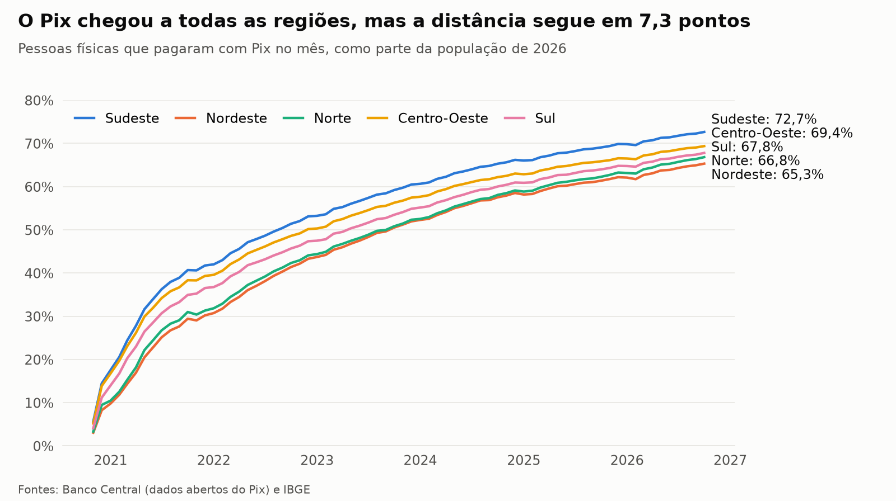
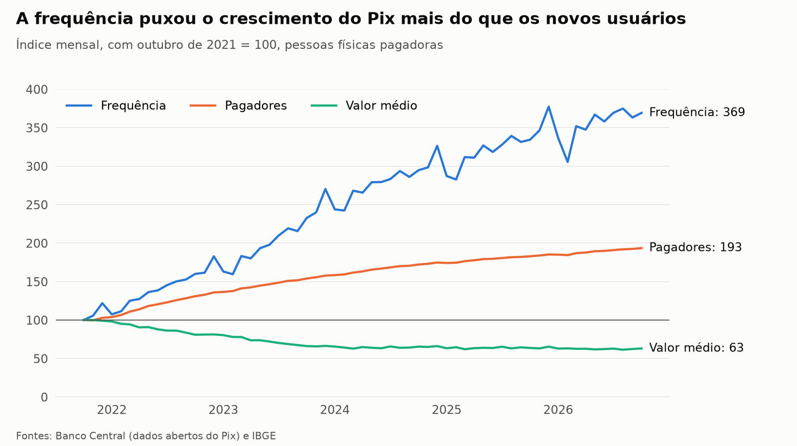
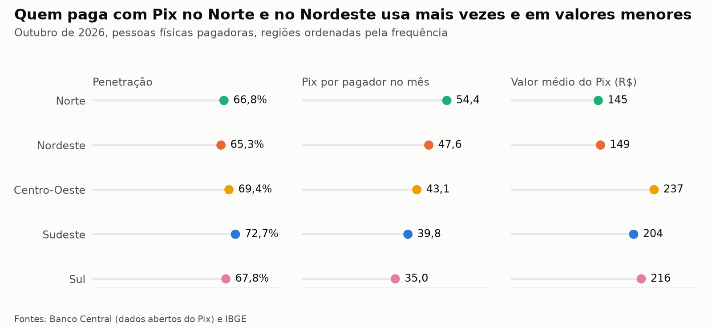
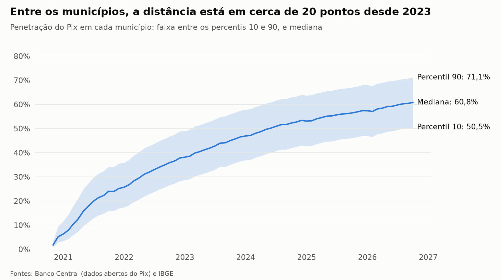

# Adoção do Pix nos municípios do Brasil

Pipeline ETL em Python e análise em SQL da adoção do Pix por pessoas físicas, de novembro de 2020 a outubro de 2026, com dados públicos do Banco Central e do IBGE.

**Pergunta:** o Pix chegou a todo o Brasil no mesmo ritmo, ou há regiões que seguem atrás? Chegou a todas, e a distância relativa caiu: a região líder tinha 1,79 vez a penetração da última em janeiro de 2021, e tem 1,11 vez agora. Em pontos, porém, a distância quase não mudou, com 7,7 pontos naquele mês e 7,3 em outubro de 2026. Quem fica atrás depende da medida: a ordem das regiões muda quando o denominador são só os adultos, e quase se inverte na frequência de uso.



## Principais resultados

| Região | Penetração | Entre adultos* | Pix por pagador no mês | Valor médio | Passou de 50% da população |
| --- | --- | --- | --- | --- | --- |
| Sudeste | 72,7% | 93,0% | 39,8 | R$ 204 | set/2022 |
| Centro-Oeste | 69,4% | 92,8% | 43,1 | R$ 237 | dez/2022 |
| Sul | 67,8% | 87,2% | 35,0 | R$ 216 | mai/2023 |
| Norte | 66,8% | 95,0% | 54,4 | R$ 145 | out/2023 |
| Nordeste | 65,3% | 88,0% | 47,6 | R$ 149 | out/2023 |

Dados de outubro de 2026. Penetração é a parte da população que pagou com Pix no mês.

\* Estimativa sem Pacaraima (RR). Serve para comparar regiões, mas não é uma parcela exata, porque passa de 100% em três UFs (DF, AP e RR).

- **Tamanho:** 148,4 milhões de pessoas físicas pagaram com Pix em outubro de 2026, ou 69,3% da população. Em novembro de 2020 eram 9,6 milhões.
- **Ativação:** os pagadores do mês equivalem a 87,9% dos usuários com chave Pix, contra 24,8% no primeiro mês.
- **Crescimento:** de outubro de 2021 a outubro de 2026, o valor mensal pago por pessoas físicas multiplicou por 4,50. Os pagadores multiplicaram por 1,93, a frequência por 3,69, e o valor médio caiu para 0,63 do inicial.
- **Ritmo:** a alta anual de pagadores foi de 30,9% em 2022 e de 5,8% em 2026. A de frequência foi de 59,9% e de 10,4%.
- **Municípios:** a distância entre os percentis 90 e 10 subiu de 8,2 pontos em janeiro de 2021 para 20,3 em janeiro de 2023, e está em 20,6. Em municípios de até 20 mil habitantes, a penetração é de 59,4%. Nos de mais de 500 mil, é de 78,2%.
- **Pagamentos:** a parcela de Pix recebida por empresas passou de 7,5% para 50,0%.







## Testes de auditoria

- **Conciliação:** no total do país, todo Pix pago precisa ter sido recebido. Dos 72 meses, 67 fecham exatamente. Os outros 5 têm diferença de até 0,0014% do valor do mês (R$ 7.491.090 em novembro de 2021). Uma nova consulta à API devolveu os mesmos valores, então a diferença está na fonte.
- **Valor atípico:** Pacaraima (RR) tem 179.432 pagadores para 24.132 moradores, ou 7,4 vezes a população. Em outubro de 2021, já eram 1,15 vez. Só esse município levava Roraima ao primeiro lugar entre as UFs. Sem ele, o estado cai de 92,5% para 71,2% e fica em 5º lugar. Pacaraima fica na fronteira com a Venezuela, mas a base não permite afirmar a causa.
- **Série incompleta:** três municípios só aparecem em 2025 (Campo Grande e Januário Cicco, no RN, e Boa Esperança do Norte, em MT). Eles ficam fora da análise de percentis.

## Como foi feito

1. **Extração:** o pipeline baixa as bases mês a mês nas APIs do Banco Central e do IBGE, com novas tentativas em caso de falha.
2. **Transformação:** ele limpa as colunas, monta a dimensão de municípios e roda 9 testes de qualidade. Qualquer falha interrompe a execução.
3. **Carga:** ele grava 401.019 linhas em um banco SQLite com chaves primárias, chaves estrangeiras e restrições `CHECK`.
4. **Análise:** as consultas em [`sql/`](sql) usam CTEs e funções de janela (`LAG`, `RANK`, `ROW_NUMBER` e `PERCENT_RANK`).
5. **Sensibilidade:** a análise repete a comparação sem Pacaraima e só com adultos, para ver se a conclusão depende da medida.

A análise completa está em [`adocao_pix.ipynb`](adocao_pix.ipynb). A última célula imprime os números deste README.

## Como rodar

```bash
pip install -r requirements.txt
jupyter notebook adocao_pix.ipynb
```

O notebook roda o pipeline na primeira célula, usando os dados de `dados/brutos`. Para rodar só o pipeline:

```bash
python etl/pipeline.py
```

Para baixar tudo de novo das APIs:

```bash
python etl/pipeline.py --atualizar
```

O período vai até outubro de 2026 e fica fixo em `etl/extrair.py`. Os dados foram extraídos em 6 de novembro de 2026, e uma nova extração pode trazer revisões do Banco Central. Projeto testado com Python 3.14.

## Limites

- **Contagem de pessoas:** a documentação da API não define o campo de pagadores. Tratei o campo como pessoas distintas em cada município. A soma do país (148,4 milhões) fica abaixo dos 168,8 milhões de usuários cadastrados, mas isso não prova que não há dupla contagem.
- **Município:** a base não informa como o pagador é ligado ao município, então ele pode não morar lá.
- **Retenção:** a base é agregada, sem dados por pessoa. Por isso não há coortes nem retenção real, e os pagadores do mês mostram só o saldo.
- **Ativação:** é uma aproximação, porque é possível usar o Pix sem ter chave cadastrada.
- **População:** usei a estimativa de 2026 para todos os meses, o que reduz um pouco a penetração dos primeiros anos. Os adultos são estimados com a parcela do Censo 2022 em cada UF.
- **Valores:** são nominais, sem correção pela inflação.
- **Causa:** a análise descreve o que aconteceu, sem explicar o motivo.

## Fontes

- Banco Central do Brasil, [dados abertos do Pix](https://dadosabertos.bcb.gov.br/dataset/pix), licença ODbL.
- IBGE, [SIDRA](https://sidra.ibge.gov.br), tabelas 6579 (estimativas de população) e 9514 (Censo 2022).
